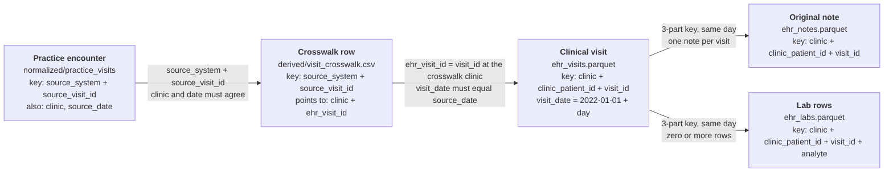

# Clinical integration and row accounting

Component: `spark/integrate_clinical.sc` (owner: Hani). It links practice encounters to clinical visits through the TailSignal crosswalk, attaches the original notes and lab rows, and writes `visits`, `clinical_notes` and `lab_results` as separate Parquet tables. Every input row is either accepted or written to an exceptions table with a reason, and the job prints a reconciliation for each input.

Target environment: ISIT312 Big Data VM with Hadoop 2.7.3, Spark 3.0.3 and Scala 2.12.10, `spark-shell --master local[2]`.

| | Path |
| --- | --- |
| Reads | `raw/<batch>/data/ehr/ehr_visits.parquet`, `ehr_notes.parquet`, `ehr_labs.parquet`, `raw/<batch>/derived/visit_crosswalk.csv` |
| Reads (practice) | `normalized/<batch>/practice_visits` from `spark/normalize_practice.sc`, or `fixtures/practice_visits.csv` |
| Writes | `accepted/<batch>/visits`, `accepted/<batch>/clinical_notes`, `accepted/<batch>/lab_results` |
| Writes (exceptions) | `exceptions/<batch>/integrate_clinical` |

Paths are relative to `ISIT312_HDFS_ROOT` (default `/isit312/vet`). Outputs are overwritten, so rerunning a batch reproduces the same rows without appending duplicates.

## Run it on the course VM

Start HDFS as in the course lab and wait for safe mode to clear. Then, from the repository folder:

```bash
# 1. Land the raw files. Note the batch ID in the printed "Raw:" path.
bash smoke/run_first_visit.sh ~/tailsignal_vet_dataset.zip
SMOKE=smoke-YYYYMMDDTHHMMSS-NNNN          # from the Raw: line

# 2. Fixture mode: two practice rows, written to accepted/<batch>-fixture.
bash spark/run_integrate_clinical.sh fixture "$SMOKE"

# 3. Full batch. Copy the raw files to their own batch ID so the smoke baseline tables stay untouched,
#    then run Alina's parser and the integration job in order.
hdfs dfs -cp "/isit312/vet/raw/$SMOKE" /isit312/vet/raw/hani-full-01
RUN_PARSER=1 bash spark/run_integrate_clinical.sh full hani-full-01

# 4. Fault test: injects one example of each problem into a small copy under /isit312/vet/_test.
bash spark/run_integrate_clinical.sh faults hani-full-01

# 5. Aaron's integration checks on the new tables (8 checks at zero, 4 faults caught).
ISIT312_BASELINE=/isit312/vet/accepted/hani-full-01 ISIT312_CHECKS_SQL=sql/checks/integration.sql \
  bash -c 'printf ":paste tests/run_integration_checks.sc\n:quit\n" | $SPARK_HOME/bin/spark-shell --master local[2]'

# 6. Register the tables in Hive and run the Beeline evidence queries (start the metastore and HiveServer2 first).
$HIVE_HOME/bin/beeline -u jdbc:hive2://localhost:10000 --hivevar db=isit312_vet \
  --hivevar accepted=/isit312/vet/accepted/hani-full-01 \
  --hivevar exceptions=/isit312/vet/exceptions/hani-full-01/integrate_clinical \
  -f sql/hive/integration_tables.sql
$HIVE_HOME/bin/beeline -u jdbc:hive2://localhost:10000 --hivevar db=isit312_vet -f sql/hive/integration_checks.sql
```

Each wrapper run saves its log under `logs/` and ends with `PASS (<mode>)`. A failed Spark command or missing final marker stops the run. With `RUN_PARSER=1`, use the default paths for the batch. The parser runs in its own session and must print `ISIT312_PRACTICE_PASS` before integration starts. Register the batch in Hive after `PASS (full)` appears. Use a fresh batch ID for a final run so an incomplete retry cannot replace a batch already used by Hive.

## How the records connect



The practice exports and the clinical system use separate patient IDs. Alpha `patient_id` and Beta `patient.id` never equal the EHR `clinic_patient_id` (0 of 36,421 linked Alpha and Beta visits), and Gamma has no patient ID. The crosswalk is the only bridge between the two layers, so a practice encounter links to a visit only through `(source_system, source_visit_id) → ehr_visit_id`.

Demo example: Alpha `V533959` at SITE-08 on 2024-07-14 → crosswalk → `EV0033960` (`SITE-08-00886`, day 925 = 2024-07-14) → one note and seven lab rows.

## Rules

**Duplicates and blank fields.** The same rule applies to every input:

- A row with a blank or unreadable required field is set aside as `MISSING_REQUIRED_FIELD`.
- Copies of a key with identical content are a repeated import. One copy is kept and each extra copy is logged as `EXACT_REPEAT`.
- Copies of a key with different content are all set aside as `CONFLICTING_DUPLICATE`, because the job cannot tell which one is right.

Keys: clinical visits and notes use `(clinic, clinic_patient_id, visit_id)`; lab rows add `analyte`; crosswalk and practice rows use `(source_system, source_visit_id)`. If two crosswalk rows point at the same visit, both are set aside as `CONFLICTING_TARGET`, so a visit never carries two practice encounters.

**Linking a practice encounter.** Checks run in this order and the first failure decides the reason:

| Check | Reason when it fails |
| --- | --- |
| The encounter has a crosswalk row | `PRACTICE_ONLY` (expected unmatched, not an error) |
| That crosswalk row passed its own checks | `CROSSWALK_ROW_REJECTED` |
| Practice clinic equals crosswalk clinic | `CLINIC_MISMATCH` |
| Practice date equals crosswalk date | `DATE_MISMATCH` |
| The crosswalk `ehr_visit_id` is an accepted visit at that clinic | `TARGET_VISIT_NOT_FOUND` |
| That visit ID belongs to one patient at that clinic | `TARGET_VISIT_AMBIGUOUS` |
| Practice date equals the visit date | `DATE_MISMATCH` |

In full scope, a crosswalk row whose practice encounter is missing from the practice input is logged as `SOURCE_RECORD_NOT_FOUND`. In sample scope (the fixture), those visits are marked `source_not_loaded` instead, because the fixture only holds two encounters.

**Notes and labs.** A note or lab row is accepted when its 3-part key matches an accepted visit and its `day` equals the visit's `day`. Otherwise it is set aside as `ORPHAN_NOTE`, `ORPHAN_LAB` or `DAY_MISMATCH`. Visits are never dropped because of a link problem: a visit whose link fails keeps a null source pair and `link_status = 'link_rejected'`.

## Output tables

Hive definitions: [`sql/hive/integration_tables.sql`](../sql/hive/integration_tables.sql). The first three tables keep every column the baseline had, so existing checks and reports still work.

### `visits`: one row per accepted clinical visit

| Column | Type | Notes |
| --- | --- | --- |
| `clinic`, `clinic_patient_id`, `visit_id` | STRING | Visit key from `ehr_visits.parquet` |
| `visit_date` | DATE | `date_add(DATE '2022-01-01', day)` |
| `day` | INT | Original offset |
| `visit_type`, `dx`, `procedure` | STRING | As supplied |
| `source_system`, `source_visit_id` | STRING | Linked practice encounter; both null unless matched |
| `link_method` | STRING | From the crosswalk when matched |
| `link_status` | STRING | `matched`, `clinical_only`, `link_rejected` or `source_not_loaded` |
| `practice_source_path` | STRING | Practice export file of the linked encounter |
| `crosswalk_path` | STRING | `derived/visit_crosswalk.csv` when matched |
| `source_path` | STRING | `data/ehr/ehr_visits.parquet` |
| `batch_id` | STRING | |

### `clinical_notes`: one original note per accepted visit

`clinic`, `clinic_patient_id`, `visit_id` (STRING), `day` (INT), `text` (STRING, as supplied), `source_path` (`data/ehr/ehr_notes.parquet`), `batch_id`.

### `lab_results`: one row per accepted visit and analyte

`clinic`, `clinic_patient_id`, `visit_id` (STRING), `day` (INT), `reason` (STRING), `analyte` (STRING, unit in the name, e.g. `creatinine_mg_dl`), `value` (DOUBLE), `source_path` (`data/ehr/ehr_labs.parquet`), `batch_id`.

### `exceptions/<batch>/integrate_clinical`: every row not accepted as supplied

| Column | Notes |
| --- | --- |
| `batch_id`, `component` | `component` is `integrate_clinical` |
| `record_type` | `practice_visit`, `crosswalk`, `ehr_visit`, `clinical_note` or `lab_result` |
| `source_path` | Archive-relative file the row came from |
| `reason_code` | See the rules above |
| `category` | `expected_unmatched`, `invalid_link`, `duplicate_key`, `missing_key` or `orphan_child` |
| `clinic`, `clinic_patient_id`, `visit_id` | Clinical keys when known. For link exceptions `visit_id` is the crosswalk target. |
| `source_system`, `source_visit_id` | Practice keys when known |
| `detail` | Human-readable cause, e.g. `practice 2024-07-04 vs crosswalk 2024-07-03` |

## Results on the full TailSignal v1 batch

These figures come from a local run of the same scripts in Spark 3.0.3 and Scala 2.12.10, which are the course VM versions, and from Hive 3.1.3 for the Beeline queries. The job asserts the reference totals, so a VM run that prints `ISIT312_INTEGRATION_PASS` has reproduced them. Replace this note with the VM log and screenshot.

| Input | Outcome | Rows |
| --- | --- | ---: |
| Practice encounters | Input (Alpha 18,881, Beta 17,571, Gamma 16,715) | 53,167 |
| | Matched to a clinical visit (18,866 / 17,555 / 16,702) | 53,123 |
| | Practice-only, no crosswalk row (15 / 16 / 13) | 44 |
| | Invalid link | 0 |
| | Duplicate or missing key | 0 |
| Crosswalk rows | Input | 53,123 |
| | Used for a matched visit | 53,123 |
| | Failed checks, set aside or without a practice encounter | 0 |
| Clinical visits | Input | 61,527 |
| | Accepted: matched | 53,123 |
| | Accepted: clinical-only | 8,404 |
| | Accepted: link rejected | 0 |
| | Set aside | 0 |
| Clinical notes | Input / accepted / set aside | 61,527 / 61,527 / 0 |
| Lab results | Input / accepted / set aside | 99,687 / 99,687 / 0 |

Visit count before and after linking: 61,527 visit rows read, 61,527 written, 61,527 distinct visit keys and 53,123 distinct source pairs. Linking never adds a row to `visits`. The exceptions table holds the 44 practice-only encounters, each with its source file and ID. Lab rows per visit are 0, 4 or 7, and the monthly visit counts still sum to 61,527, with 20 SITE-08 procedure visits in July 2024.

Aaron's `tests/run_integration_checks.sc` passes on these tables: all eight checks are zero and the four injected faults are each caught.

## Trace for EV0033960

| Step | Record |
| --- | --- |
| Practice export | `vet_alpha` `V533959`, SITE-08, 2024-07-14, owner `C568564`, invoice 650.50, `data/pims/vet_alpha_visits.csv` |
| Crosswalk | `vet_alpha,V533959,SITE-08,2024-07-14,EV0033960,tailsignal_base_visit_index` |
| Clinical visit | SITE-08, `SITE-08-00886`, `EV0033960`, day 925 = 2024-07-14, procedure (dental_cleaning), `link_status = matched` |
| Original note | "COHAT/dental under GA. ASA 2. Smooth recovery. BAR, MM pink, CRT<2. BCS 6/9, wt 5.8kg. Periodontal dz gr 2." |
| Lab rows (pre_anesthetic) | bun_mg_dl 15.1, creatinine_mg_dl 1.34, sdma_ug_dl 14.2, upc 0.08, urine_ph 6.5, usg 1.045, wbc_k_ul 10.9 |
| Visit-level summary | 1 visit row, 1 note, 7 lab rows. The child rows are counted before the join, so the visit counts once. |

A record with no match: Alpha `V517829` (SITE-08, 2023-05-07) has no crosswalk row. It is kept in the exceptions table as `PRACTICE_ONLY`, with `data/pims/vet_alpha_visits.csv` as its source. A clinical-only example is `EV0053176` (SITE-01, 2022-03-30, recheck), which is accepted with a null source pair.

## Fixture run

With `fixtures/practice_visits.csv`, `V533959` links to `EV0033960`, and `V517829` lands in the exceptions table as `PRACTICE_ONLY`. The output keeps 61,527 visits, 61,527 notes and 99,687 lab rows. Of those visits, 8,404 are clinical-only and 53,122 are `source_not_loaded` because their practice encounters are outside the fixture.

## Fault test

`tests/make_integration_faults.sc` copies the SITE-08 July 2024 visits (181 visits, including EV0033960) and injects one example of each problem. All synthetic IDs start with `FAULT`. `tests/check_integration_faults.sc` then compares the exceptions with the expected counts:

| Input | Injected fault | Expected reason | Rows |
| --- | --- | --- | ---: |
| Clinical visit | Same visit imported twice | `EXACT_REPEAT` (one copy kept) | 1 |
| Clinical visit | Two different rows for one visit | `CONFLICTING_DUPLICATE` | 2 |
| Clinical visit | Blank `clinic_patient_id` | `MISSING_REQUIRED_FIELD` | 1 |
| Note | Notes of those two set-aside visits | `ORPHAN_NOTE` | 2 |
| Note | Note day differs from its visit | `DAY_MISMATCH` | 1 |
| Note | Blank text | `MISSING_REQUIRED_FIELD` | 1 |
| Lab | EV0033960 lab row imported twice | `EXACT_REPEAT` (EV0033960 keeps 7 labs) | 1 |
| Lab | Two values for one analyte | `CONFLICTING_DUPLICATE` | 2 |
| Lab | Lab row for a visit that does not exist | `ORPHAN_LAB` | 1 |
| Crosswalk | Row supplied twice | `EXACT_REPEAT` | 1 |
| Crosswalk | Two rows point at one visit | `CONFLICTING_TARGET` | 2 |
| Crosswalk | Practice encounter missing or set aside | `SOURCE_RECORD_NOT_FOUND` | 2 |
| Practice | V533959 imported twice | `EXACT_REPEAT` (still matched) | 1 |
| Practice | Two invoice totals for one encounter | `CONFLICTING_DUPLICATE` | 2 |
| Practice | Blank `source_visit_id` | `MISSING_REQUIRED_FIELD` | 1 |
| Practice | Encounter with no crosswalk row | `PRACTICE_ONLY` | 1 |
| Practice | Crosswalk points at a visit that does not exist | `TARGET_VISIT_NOT_FOUND` | 1 |
| Practice | Its crosswalk row was set aside | `CROSSWALK_ROW_REJECTED` | 2 |
| Practice | Date one day later than the crosswalk | `DATE_MISMATCH` | 1 |
| Practice | Clinic says SITE-07, crosswalk says SITE-08 | `CLINIC_MISMATCH` | 1 |
| Visits | Visits whose link failed | `link_status = link_rejected` | 5 |
| Visits | Accepted visits (181 minus the 2 set aside) | | 179 |

All 22 rows matched in the local run, and EV0033960 stayed one matched visit with one note and seven lab rows. The test found two defects that were fixed before this commit. The crosswalk CSV had been read by column position, so a file with reordered columns would have shifted values silently; it is now checked against its header. A clinic-mismatch link also marked the wrong visit as `link_rejected`.

## Handoffs

- **Sarib.** Point the Hive tables at `accepted/<batch>`. The columns are a superset of the baseline, and `link_status` separates matched visits from clinical-only ones. `integration_exceptions` is new, and `sql/hive/integration_checks.sql` shows a drill-down that counts child rows before the join.
- **Aaron.** Run `tests/run_integration_checks.sc` with `ISIT312_BASELINE=/isit312/vet/accepted/<batch>`. The data contract could list the exceptions columns above.
- **Hashim.** After ingestion, run `RUN_PARSER=1 bash spark/run_integrate_clinical.sh full "$BATCH_ID"`. If the parser already passed for this batch, omit `RUN_PARSER=1`. Start Hive after the full mode passes.
- **Anuj and Ashrafur.** `visits` keeps one row per `(clinic, clinic_patient_id, visit_id)` with `visit_date` and `visit_type`, as in the baseline.

## Limitations

- The crosswalk comes from the TailSignal generator. A real clinic would need another way to link records, such as owner, pet and date, because the practice and clinical patient IDs do not share values. This job checks each supplied link but does not create new links.
- An exact repeat is recognised only when every column matches. A re-keyed copy of a visit under a new ID cannot be detected.
- Conflicting duplicates are all set aside. Choosing the correct version needs clinic input or the version rules in Anuj's replay job.
- Notes and labs whose day disagrees with their visit are set aside rather than corrected.
- Prescriptions and procedures are separate Parquet files and are outside this component.
- In sample scope, the job cannot tell a missing practice encounter from one that was not loaded.
